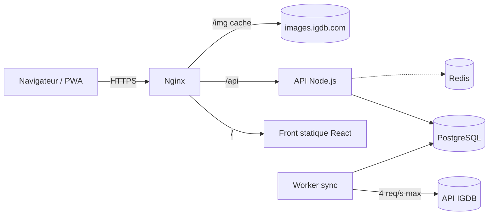

# TCG Jeux Vidéo — Spécification du projet

> Jeu web de cartes à collectionner où **chaque carte est un jeu vidéo**.
> Nom du projet : à définir. Version du document : 1.5 (12 octobre 2026).
>
> **Nouveautés de la v1.1 :** rareté figée par score de prestige et finitions (5.2), monétisation et marché (17), événements esport et pronostics (18), partenariats avec les boutiques (19). Les sections 1 à 16 gardent leur numérotation.
>
> **Nouveautés de la v1.2 :** modèle de monétisation arrêté et lancement payant en France seulement (17), événements refondus autour des pronostics, des cartes d'événement et des cosmétiques maison (18), démarches IGDB, ANJ et impôts avec les messages prêts à envoyer (20).
>
> **Nouveautés de la v1.3 :** bonus outsider en succès et coins avec ses garde-fous (18.4), liste de ce qui est bloqué hors de France (17.9), logo des boutiques partenaires (19.2).
>
> **Nouveautés de la v1.4 :** réglementation à respecter et obligations à mettre en place sur le site (21).
>
> **Nouveautés de la v1.5 :** parrainage entre joueurs (22), règles d'équilibrage des combats (23).

---

## Sommaire

1. [Vision](#1-vision)
2. [Périmètre](#2-périmètre)
3. [Catalogue et données](#3-catalogue-et-données)
4. [Exclusion des jeux à caractère sexuel](#4-exclusion-des-jeux-à-caractère-sexuel)
5. [Game design](#5-game-design)
6. [Architecture technique](#6-architecture-technique)
7. [Modèle de données](#7-modèle-de-données)
8. [Algorithme de tirage](#8-algorithme-de-tirage)
9. [API](#9-api)
10. [Front et UX](#10-front-et-ux)
11. [Sécurité et anti-triche](#11-sécurité-et-anti-triche)
12. [Légal et conformité](#12-légal-et-conformité)
13. [Infra et déploiement](#13-infra-et-déploiement)
14. [Roadmap](#14-roadmap)
15. [Décisions ouvertes](#15-décisions-ouvertes)
16. [Points à vérifier](#16-points-à-vérifier)
17. [Monétisation et marché](#17-monétisation-et-marché)
18. [Événements esport et pronostics](#18-événements-esport-et-pronostics)
19. [Partenariats avec les boutiques](#19-partenariats-avec-les-boutiques)
20. [Démarches et contacts](#20-démarches-et-contacts)
21. [Réglementation et obligations](#21-réglementation-et-obligations)
22. [Parrainage](#22-parrainage)
23. [Équilibrage des combats](#23-équilibrage-des-combats)

---

## 1. Vision

| Élément | Description |
|---|---|
| Concept | On ouvre des boosters, on obtient des cartes, chaque carte représente un jeu vidéo réel |
| Référence | Wikigacha (cartes = articles Wikipédia), appliqué au catalogue des jeux vidéo |
| Différence clé | Catalogue thématique et structuré : packs et collections par plateforme, décennie, genre, studio |
| Plateforme | Web uniquement, en PWA installable sur mobile |
| Cible | Joueurs, collectionneurs, nostalgiques du rétro |
| Boucle de jeu | Ouvrir des packs → découvrir des jeux → compléter des sets → revenir pour les packs rechargés et les missions |

**Promesse en une phrase :** « Collectionne tous les jeux vidéo jamais sortis. »

---

## 2. Périmètre

### V1 (MVP)

- Comptes utilisateurs
- Catalogue importé et filtré depuis IGDB
- Ouverture de packs (pack standard + quelques packs thématiques)
- Classeur de collection avec filtres et recherche
- Progression par set (plateforme, décennie, genre)
- Gestion des doublons
- Signalement d'une carte inappropriée
- Back-office minimal : quarantaine, liste noire, suivi des imports
- Rareté figée par série et deux monnaies prévues en base dès le départ, même sans paiement actif (très difficile à ajouter après coup)

### V2

- Missions quotidiennes et succès
- Échanges entre joueurs (le « T » de TCG)
- Profil public et classements
- Combats entre cartes
- Marché entre joueurs (section 17)
- Abonnement et coins pour le marché, en France d'abord (section 17)
- Événements esport et pronostics (section 18)
- Partenariats avec les boutiques physiques (section 19)

### Hors périmètre

- Application native iOS / Android
- Achats en argent réel **en V1** (prévus ensuite, section 17)
- Retrait d'argent réel par les joueurs, à aucun moment
- Vente directe de packs aléatoires contre de l'argent
- Cartes physiques

---

## 3. Catalogue et données

### 3.1 Source : IGDB

| Point | Détail |
|---|---|
| Accès | Compte Twitch, application enregistrée, `Client-ID` + token OAuth |
| Coût | Gratuit en usage non commercial, partenariat requis en usage commercial |
| Base URL | `https://api.igdb.com/v4` |
| Méthode | Requêtes `POST` avec un corps en langage de requête (fields, where, sort, limit) |
| Rate limit | 4 requêtes par seconde, sinon `429 Too Many Requests` |
| Navigateur | Appels impossibles depuis le front : les identifiants restent côté serveur |

**Principe :** le jeu ne lit jamais IGDB en direct. Le catalogue est copié dans notre PostgreSQL, puis synchronisé.

### 3.2 Champs utilisés

| Besoin | Champ IGDB |
|---|---|
| Identité | `id`, `name`, `slug`, `summary` |
| Date | `first_release_date` |
| Image | `cover.image_id` |
| Type d'entrée | `game_type` (`category` est déprécié) |
| Notes | `total_rating`, `total_rating_count` |
| Classement | `platforms`, `genres`, `themes` |
| Studio | `involved_companies.company`, `involved_companies.developer` |
| Classification d'âge | `age_ratings` (`organization`, `rating_category`, `rating_content_descriptions`) |
| Durée de vie | endpoint `game_time_to_beats` (champ `normally`, en secondes) |
| Popularité | endpoint `popularity_primitives` |
| Synchronisation | `updated_at` |

### 3.3 Critères d'inclusion

Un jeu devient une carte si **toutes** les conditions sont vraies :

- [ ] C'est un jeu principal (pas un DLC, une extension, un mod, un bundle, une saison)
- [ ] Il est sorti (date de sortie passée)
- [ ] Il a une jaquette
- [ ] Il est disponible sur au moins une plateforme de la liste blanche
- [ ] Il passe le filtre de contenu (section 4)

**Liste blanche des plateformes** (table `platforms`, colonne `is_official`) :

| Famille | Exemples |
|---|---|
| PC | Windows, Mac, Linux |
| PlayStation | PS1 à PS5, PSP, PS Vita |
| Xbox | Xbox, 360, One, Series |
| Nintendo | NES à Switch 2, Game Boy, DS, 3DS |
| Sega | Master System, Mega Drive, Saturn, Dreamcast |
| Mobile | iOS, Android |
| Autres historiques | Arcade, Atari, Neo Geo, Amiga (à décider) |

### 3.4 Pipeline d'import

```text
1. Token      → OAuth Twitch (client credentials), à renouveler avant expiration
2. Références → platforms, genres, themes (petites tables, import complet)
3. Jeux       → pagination par id croissant, lots de 500
4. Filtres    → inclusion (3.3) + contenu (section 4)
5. Calculs    → rareté, ATK, DEF (section 5)
6. Pools      → reconstruction des tables de tirage (section 8)
7. Journal    → une ligne dans sync_runs (durée, ajouts, exclusions, erreurs)
```

Exemple de requête (noms et valeurs à valider sur la doc officielle) :

```text
fields name, slug, summary, first_release_date, cover.image_id, game_type,
       total_rating, total_rating_count, platforms, genres, themes,
       age_ratings.organization, age_ratings.rating_category,
       age_ratings.rating_content_descriptions,
       involved_companies.company.name, involved_companies.developer,
       updated_at;
where id > {last_id} & game_type = 0 & cover != null;
sort id asc;
limit 500;
```

| Type de sync | Fréquence | Filtre |
|---|---|---|
| Import initial | Une fois | Tout le catalogue |
| Incrémental | Chaque nuit | `updated_at > {dernière_sync}` |
| Recalcul de la cote | Chaque semaine | Sur notre base uniquement, sans effet sur la rareté (5.2) |
| Calcul des raretés | À chaque nouvelle série | Sur notre base uniquement |

**Règle de stabilité :** une carte déjà possédée par un joueur n'est jamais supprimée. Si le jeu sort du catalogue, la carte est retirée du tirage (`is_drawable = false`) mais reste dans les classeurs.

**File d'attente :** un seul worker, limité à 3 requêtes par seconde pour garder une marge, avec retry et backoff sur `429`.

---

## 4. Exclusion des jeux à caractère sexuel

### 4.1 Définition

| Cas | Décision |
|---|---|
| Jeu dont le contenu sexuel est le propos principal (eroge, hentai, jeu pornographique) | **Exclu** |
| Jeu grand public contenant des scènes sexuelles ou de la nudité (The Witcher 3, GTA V, Mass Effect) | **Conservé** |

Conséquence : on ne peut pas exclure sur le simple descripteur « Sexual Content » ou sur PEGI 18, car on perdrait une grande partie des jeux majeurs.

### 4.2 Règles automatiques

| # | Règle | Action |
|---|---|---|
| R1 | Thème IGDB « Erotic » | Exclusion |
| R2 | Classification ESRB « Adults Only » | Exclusion |
| R3 | Mots-clés dans le nom ou les keywords (hentai, eroge, nsfw, 18+, etc.) | Quarantaine |
| R4 | Descripteur « Strong Sexual Content » **et** faible popularité | Quarantaine |
| R5 | Présent dans `blocked_games` | Exclusion |

### 4.3 Trois états

| État | Dans le tirage | Visible |
|---|---|---|
| `eligible` | Oui | Oui |
| `quarantine` | Non | Back-office uniquement, en attente de revue manuelle |
| `excluded` | Non | Non |

**Principe de prudence :** en cas de doute, quarantaine. Un jeu absent du tirage ne gêne personne, un jeu inapproprié tiré par un joueur abîme le projet.

### 4.4 Filets de sécurité

- **Signalement** : bouton sur chaque carte. À partir d'un seuil de signalements (par exemple 3), passage automatique en quarantaine.
- **Jaquettes** : un jeu peut être acceptable avec une jaquette suggestive. Le signalement couvre aussi ce cas, avec possibilité de remplacer l'image par un visuel neutre.
- **Liste noire versionnée** : `blocked_games` conserve la raison et l'auteur, et survit aux réimports.
- **Revue initiale** : avant l'ouverture, passer en revue manuellement toutes les cartes Épique et au-dessus (les plus vues), soit quelques milliers d'entrées au maximum.

---

## 5. Game design

### 5.1 Anatomie d'une carte

| Zone | Contenu |
|---|---|
| Visuel | Jaquette du jeu |
| Titre | Nom du jeu |
| Bandeau | Année de sortie, plateforme principale |
| Type | Genre principal (icône + couleur) |
| Stats | ATK et DEF |
| Pied | Studio de développement, numéro de carte, rareté |
| Finition | Cadre par rareté, effet holographique à partir d'Épique |

### 5.2 Raretés

**Principe :** une carte est rare si le jeu est à la fois **bien noté** et **connu**, comparé aux jeux de **sa décennie**. La rareté est calculée une seule fois, puis **figée**.

Pourquoi pas la popularité seule : tous les Légendaires seraient des AAA récents. Pourquoi pas la note seule : un jeu obscur noté 95 par trois personnes passerait devant les classiques.

#### Calcul du score de prestige

```text
WR    = (v / (v + m)) × R + (m / (v + m)) × C
score = WR × log10(1 + v)
```

| Variable | Sens | Source |
|---|---|---|
| `R` | Note du jeu, sur 100 | `total_rating` |
| `v` | Nombre de notes | `total_rating_count` |
| `C` | Note moyenne de tous les jeux notés du catalogue | Calculée à l'import |
| `m` | Seuil de confiance | 50 au départ |

- `WR` est la note fiabilisée : un jeu avec peu de notes est ramené vers la moyenne, un jeu très noté garde presque sa vraie note.
- `log10(1 + v)` récompense la notoriété sans qu'elle écrase tout.
- IGDB renvoie déjà la note sur 100 (le « 8,5 sur 10 » affiché sur certains sites est la même valeur divisée par 10). `R` et `C` doivent seulement être sur la même échelle.

**Exemples** (avec `C` = 70, valeur supposée en attendant l'import) :

| Jeu | Note | Nb de notes | WR | Score |
|---|---|---|---|---|
| Obscur surnoté | 95 | 3 | 71,4 | 43 |
| Excellent jeu de niche | 92 | 150 | 86,5 | 188 |
| Jeu moyen très connu | 60 | 3 000 | 60,2 | 209 |
| **Minecraft: Java Edition** | 84,8 | 2 035 | 84,4 | **279** |
| Classique reconnu | 90 | 2 000 | 89,5 | 296 |

Détail pour Minecraft: Java Edition (sorti le 18 novembre 2011, chiffres relevés sur des sites qui republient les données IGDB) :

```text
WR    = (2 035 / 2 085) × 84,8 + (50 / 2 085) × 70 = 82,77 + 1,68 = 84,4
score = 84,4 × log10(2 036) = 84,4 × 3,309 = 279
```

Sa carte : ATK 85, DEF 66 (formules 5.3). Classé dans les années 2010, il sort Légendaire s'il entre dans le quota de la décennie, Ultra rare sinon. Dans ce second cas, la liste manuelle le remonte en Légendaire.

#### Attribution des paliers

1. Un jeu sans aucune note est **Commun**, sans calcul.
2. Les jeux notés sont rangés par **décennie de sortie**, puis triés par score décroissant. À égalité, celui qui a le plus de notes passe devant.
3. Les places **Légendaire** et **Ultra rare** sont en nombre fixe, réparties entre les décennies en proportion de leur nombre de jeux notés, avec un minimum par décennie.
4. Les paliers suivants sont des pourcentages des jeux notés de la décennie.
5. Une **liste manuelle** (`rarity_overrides`) impose une rareté minimale à un jeu précis. Ces ajouts viennent en plus des quotas, ils ne prennent la place de personne.

| Rareté | Code | Attribution | Minimum par décennie |
|---|---|---|---|
| Légendaire | L | 250 au total | 10 |
| Ultra rare | UR | 1 500 au total | 60 |
| Épique | E | Les 4 % suivants des jeux notés de la décennie | — |
| Rare | R | Les 10 % suivants | — |
| Peu commun | U | Reste des jeux notés | — |
| Commun | C | Tous les jeux sans note | — |

Ce système dit seulement à quel palier appartient chaque jeu. La fréquence de sortie de chaque palier dans un pack est réglée à part (5.4).

#### Rareté figée, cote et séries

Avec un marché et de l'argent réel, un joueur ne peut pas voir sa Légendaire devenir Ultra rare, ni voir 30 nouvelles Légendaires dévaluer la sienne. On sépare donc ce qui est figé de ce qui bouge :

| Élément | Comportement |
|---|---|
| **Rareté** | Calculée à la création de la carte, puis figée pour toujours : ni hausse, ni baisse |
| **Cote** | Le score recalculé chaque semaine, affiché sur la carte comme une tendance, sans effet sur la rareté |
| **Séries** | Nouvelle série tous les X mois, avec un nouveau calcul. Un jeu peut y être réimprimé à une autre rareté, les anciennes cartes ne changent pas |
| **Nouveaux jeux** | Ils entrent dans le catalogue à la série suivante, une fois leurs notes stabilisées |
| **Exemplaires en circulation** | Affichés sur chaque carte : c'est la rareté réelle, et elle est exacte |

La fiabilité vient du fait que la règle est figée, publiée et vérifiable. Le calcul lui-même reste une approximation.

#### Finitions

Indépendantes de la rareté, tirées à chaque carte obtenue :

| Finition | Probabilité de départ |
|---|---|
| Normale | Le reste |
| Holo | 1 sur 20 |
| Full art | 1 sur 200 |
| Finition d'événement | Uniquement pendant un événement (section 18) |

Elles créent de la chasse même sur les Communs, sans ajouter de paliers.

#### Limites connues et garde-fous

- **Le score suit surtout la notoriété** : la note varie d'environ 60 à 95, le facteur de votes de 0,3 à 3,7. Un jeu moyen très connu passe devant un excellent jeu de niche (209 contre 188 dans le tableau). Pour l'inverse, donner plus de poids à la note, par exemple en la mettant au carré.
- **Les votes IGDB sont peu nombreux et probablement biaisés** : jeux mobiles, jeux sortis seulement au Japon et très vieux jeux risquent d'être sous-représentés. À confirmer à l'import.
- **Le bas du classement est du bruit** : entre 4 et 6 votes, l'écart ne veut rien dire. Sans conséquence, ces cartes sont Peu communes.
- **Les éditions multiples divisent les votes** d'un même jeu (Minecraft Java, Bedrock, consoles). Voir la décision n°4.
- **Test visuel obligatoire avant de figer une série** : sortir le top 50 de chaque décennie et le lire. Si la liste a l'air juste, le système est bon ; sinon ajuster `m` ou le poids de la note.

Les valeurs 50, 250, 1 500, 4 %, 10 % et les minimums par décennie sont des réglages de départ, à ajuster après le premier import.

### 5.3 Stats

| Stat | Formule de départ | Plage |
|---|---|---|
| ATK | `round(total_rating)`, 50 par défaut si aucune note | 0 à 100 |
| DEF | `min(100, round(20 × log10(1 + total_rating_count)))` | 0 à 100 |

Repères DEF : 10 notes → 21, 100 → 40, 1 000 → 60, 10 000 → 80.

Les stats ne servent qu'à l'affichage en V1. Elles prennent leur sens avec les combats en V2.

### 5.4 Packs

| Paramètre | Valeur de départ |
|---|---|
| Cartes par pack | 5 |
| Stock maximum | 10 packs |
| Recharge | 1 pack toutes les 5 minutes |
| Doublon dans un même pack | Interdit |

**Probabilités par emplacement :**

| Emplacement | C | U | R | E | UR | L |
|---|---|---|---|---|---|---|
| 1 à 3 | 75 % | 22 % | 3 % | — | — | — |
| 4 | — | 70 % | 24 % | 5 % | 1 % | — |
| 5 | — | — | 70 % | 22 % | 7 % | 1 % |

**Garantie (pity) :** après 10 packs consécutifs sans carte Épique ou supérieure, l'emplacement 5 du pack suivant est Épique au minimum. Le compteur revient à zéro à chaque Épique ou plus.

Toutes ces valeurs sont stockées en configuration (table ou fichier), pas en dur dans le code.

Les taux de drop sont **publiés dans le jeu**. Toute modification ne s'applique qu'aux packs futurs, et chaque tirage est journalisé côté serveur pour être vérifiable en cas de litige.

### 5.5 Packs thématiques

| Type | Exemples |
|---|---|
| Plateforme | Pack Nintendo 64, Pack PS2, Pack PC |
| Décennie | Pack années 90, Pack années 2000 |
| Genre | Pack RPG, Pack Plateforme, Pack Horreur |
| Studio / franchise | Pack FromSoftware, Pack Final Fantasy |
| Événement | Pack « Jeux de l'année », pack de saison |

Un pack thématique est un pack standard avec un filtre sur le pool de tirage. Il s'achète avec la monnaie du jeu (5.6).

### 5.6 Doublons et monnaie

Les doublons sont comptés (`quantity`) et recyclables en **éclats** :

| Rareté | Éclats par doublon recyclé |
|---|---|
| C | 1 |
| U | 3 |
| R | 10 |
| E | 40 |
| UR | 150 |
| L | 500 |

| Dépense | Coût de départ |
|---|---|
| Pack thématique | 100 éclats |
| Pack standard supplémentaire | 50 éclats |

Aucun achat en argent réel en V1. Les éclats sont la monnaie **gagnée en jouant** ; la monnaie payante (coins) est décrite en section 17.

### 5.7 Collection et sets

- **Classeur** : grille de cartes, tri par rareté, date d'obtention, année, nom. Filtres par plateforme, genre, décennie, rareté.
- **Sets** : progression chiffrée, par exemple « Nintendo 64 : 42 / 388 ».
- **Emplacements vides** : les cartes non obtenues apparaissent en silhouette dans un set, pour donner envie de le compléter.
- **Favoris** : épingler des cartes en vitrine sur le profil.

### 5.8 V2 en bref

| Fonction | Principe |
|---|---|
| Missions | Ouvrir N packs, obtenir une Rare+, compléter 1 % d'un set → récompense en packs ou éclats |
| Succès | Paliers permanents : 100 cartes, 1 000 cartes, premier Légendaire, set complet |
| Échanges | Proposition carte contre carte, validation des deux côtés, limite quotidienne anti-abus |
| Combats | Équipe de 5 cartes, comparaison ATK / DEF, avantage de type selon le genre |
| Marché | Vente de cartes entre joueurs, avec taxe sur chaque vente (section 17) |
| Événements | Packs, finitions et missions liés aux tournois esport, pronostics gratuits (section 18) |

---

## 6. Architecture technique

### 6.1 Stack

| Couche | Choix |
|---|---|
| Front | React + TypeScript + Vite, PWA |
| API | Node.js + TypeScript (Fastify ou Express) |
| Base | PostgreSQL |
| Cache / rate limiting | Redis (optionnel en V1) |
| Worker | Script Node.js planifié (cron) pour la sync IGDB |
| Reverse proxy | Nginx (TLS, cache des images, fichiers statiques) |
| Conteneurs | Docker Compose |

### 6.2 Schéma



### 6.3 Images

| Option | Avantage | Inconvénient |
|---|---|---|
| Hotlink direct vers IGDB | Zéro stockage | Dépendance totale, pas de contrôle |
| **Nginx `proxy_cache` (recommandé en V1)** | Simple, cache à la demande | Premier chargement plus lent |
| Téléchargement complet | Indépendance | Stockage important, à mesurer |

---

## 7. Modèle de données

```sql
-- Catalogue
CREATE TABLE games (
  id                 integer PRIMARY KEY,          -- id IGDB
  name               text NOT NULL,
  slug               text NOT NULL,
  summary            text,
  first_release_date date,
  cover_image_id     text,
  game_type          smallint,
  total_rating       real,
  total_rating_count integer NOT NULL DEFAULT 0,
  time_to_beat_sec   integer,
  developer_name     text,
  rarity             smallint,                     -- 1=C ... 6=L
  atk                smallint,
  def                smallint,
  status             text NOT NULL DEFAULT 'eligible', -- eligible | quarantine | excluded
  status_reason      text,
  is_drawable        boolean NOT NULL DEFAULT true,
  igdb_updated_at    timestamptz,
  synced_at          timestamptz NOT NULL DEFAULT now()
);

CREATE TABLE platforms (id integer PRIMARY KEY, name text NOT NULL, family text, is_official boolean NOT NULL DEFAULT false);
CREATE TABLE genres    (id integer PRIMARY KEY, name text NOT NULL);
CREATE TABLE themes    (id integer PRIMARY KEY, name text NOT NULL);

CREATE TABLE game_platforms (game_id integer REFERENCES games, platform_id integer REFERENCES platforms, PRIMARY KEY (game_id, platform_id));
CREATE TABLE game_genres    (game_id integer REFERENCES games, genre_id    integer REFERENCES genres,    PRIMARY KEY (game_id, genre_id));
CREATE TABLE game_themes    (game_id integer REFERENCES games, theme_id    integer REFERENCES themes,    PRIMARY KEY (game_id, theme_id));

-- Modération
CREATE TABLE blocked_games (
  game_id    integer PRIMARY KEY,
  reason     text NOT NULL,
  created_by integer,
  created_at timestamptz NOT NULL DEFAULT now()
);

CREATE TABLE reports (
  id         bigserial PRIMARY KEY,
  user_id    integer NOT NULL,
  game_id    integer NOT NULL REFERENCES games,
  reason     text NOT NULL,
  status     text NOT NULL DEFAULT 'open',         -- open | accepted | rejected
  created_at timestamptz NOT NULL DEFAULT now(),
  UNIQUE (user_id, game_id)
);

-- Joueurs
CREATE TABLE users (
  id               serial PRIMARY KEY,
  username         text UNIQUE NOT NULL,
  email            text UNIQUE NOT NULL,
  password_hash    text NOT NULL,
  role             text NOT NULL DEFAULT 'player',  -- player | admin
  packs_available  smallint NOT NULL DEFAULT 10,
  packs_updated_at timestamptz NOT NULL DEFAULT now(),
  pity_counter     smallint NOT NULL DEFAULT 0,
  shards           integer NOT NULL DEFAULT 0,
  created_at       timestamptz NOT NULL DEFAULT now()
);

CREATE TABLE user_cards (
  user_id           integer REFERENCES users,
  game_id           integer REFERENCES games,
  quantity          integer NOT NULL DEFAULT 1 CHECK (quantity > 0),
  is_favorite       boolean NOT NULL DEFAULT false,
  first_obtained_at timestamptz NOT NULL DEFAULT now(),
  PRIMARY KEY (user_id, game_id)
);

-- Packs
CREATE TABLE pack_types (
  id        serial PRIMARY KEY,
  code      text UNIQUE NOT NULL,                  -- standard, n64, rpg, 1990s...
  name      text NOT NULL,
  filter    jsonb NOT NULL DEFAULT '{}',           -- {"platform_id": 4} etc.
  cost      integer NOT NULL DEFAULT 0,            -- en éclats, 0 = pack rechargeable
  is_active boolean NOT NULL DEFAULT true
);

CREATE TABLE pack_openings (
  id              bigserial PRIMARY KEY,
  user_id         integer NOT NULL REFERENCES users,
  pack_type_id    integer NOT NULL REFERENCES pack_types,
  idempotency_key uuid NOT NULL,
  cards           jsonb NOT NULL,                  -- [{game_id, rarity, is_new}]
  opened_at       timestamptz NOT NULL DEFAULT now(),
  UNIQUE (user_id, idempotency_key)
);

-- Tirage (reconstruit après chaque sync)
CREATE TABLE draw_pool (
  pack_type_id integer  NOT NULL,
  rarity       smallint NOT NULL,
  idx          integer  NOT NULL,                  -- 1..n, sans trou
  game_id      integer  NOT NULL,
  PRIMARY KEY (pack_type_id, rarity, idx)
);

CREATE TABLE draw_pool_counts (
  pack_type_id integer  NOT NULL,
  rarity       smallint NOT NULL,
  n            integer  NOT NULL,
  PRIMARY KEY (pack_type_id, rarity)
);

-- Suivi des imports
CREATE TABLE sync_runs (
  id          serial PRIMARY KEY,
  kind        text NOT NULL,                       -- full | incremental | rarity
  started_at  timestamptz NOT NULL DEFAULT now(),
  finished_at timestamptz,
  added       integer DEFAULT 0,
  updated     integer DEFAULT 0,
  excluded    integer DEFAULT 0,
  quarantined integer DEFAULT 0,
  error       text
);

CREATE INDEX games_status_rarity_idx ON games (status, rarity) WHERE is_drawable;
CREATE INDEX user_cards_user_idx     ON user_cards (user_id, first_obtained_at DESC);
```

### 7.1 Ajouts de la v1.1

Le schéma ci-dessus décrit la V1 d'origine. Les ajouts suivants le complètent, à intégrer **dès la première migration** pour la rareté et les monnaies.

**Changements sur l'existant :**

- `games.rarity` disparaît : la rareté appartient à la carte d'une série (`cards.rarity`), plus au jeu.
- `games` gagne `release_decade` et `prestige_score` (la cote, recalculée chaque semaine).
- `user_cards`, `draw_pool` et `pack_openings` référencent `card_id` au lieu de `game_id`.
- `users` gagne `coins` (monnaie payante), à côté de `shards` (monnaie gagnée).

```sql
-- Séries et rareté figée
CREATE TABLE series (
  id            serial PRIMARY KEY,
  code          text UNIQUE NOT NULL,
  name          text NOT NULL,
  rarity_params jsonb NOT NULL,                  -- m, quotas, pourcentages utilisés
  released_at   timestamptz
);

CREATE TABLE cards (
  id             serial PRIMARY KEY,
  series_id      integer  NOT NULL REFERENCES series,
  game_id        integer  NOT NULL REFERENCES games,
  rarity         smallint NOT NULL,              -- figée à la création
  score_at_print real     NOT NULL,              -- score de prestige au moment du calcul
  UNIQUE (series_id, game_id)
);

CREATE TABLE rarity_overrides (
  game_id    integer PRIMARY KEY REFERENCES games,
  min_rarity smallint NOT NULL,
  reason     text NOT NULL
);

-- Collection : finition et cartes liées au compte
CREATE TABLE user_cards (
  user_id           integer REFERENCES users,
  card_id           integer REFERENCES cards,
  finish            text    NOT NULL DEFAULT 'normal',  -- normal | holo | full_art | code d'événement
  is_bound          boolean NOT NULL DEFAULT false,     -- true = ni vendable ni échangeable
  quantity          integer NOT NULL DEFAULT 1 CHECK (quantity > 0),
  is_favorite       boolean NOT NULL DEFAULT false,
  first_obtained_at timestamptz NOT NULL DEFAULT now(),
  PRIMARY KEY (user_id, card_id, finish, is_bound)
);

-- Monnaies : tout mouvement est tracé
CREATE TABLE currency_ledger (
  id         bigserial PRIMARY KEY,
  user_id    integer NOT NULL REFERENCES users,
  currency   text    NOT NULL,                   -- shards | coins
  delta      integer NOT NULL,
  reason     text    NOT NULL,                   -- recycle | purchase | market_sale | market_fee | reward...
  ref_id     bigint,
  created_at timestamptz NOT NULL DEFAULT now()
);

CREATE TABLE subscriptions (
  user_id            integer PRIMARY KEY REFERENCES users,
  provider_ref       text NOT NULL,              -- identifiant chez le prestataire de paiement
  status             text NOT NULL,              -- active | past_due | canceled
  current_period_end timestamptz NOT NULL
);

-- Marché
CREATE TABLE market_listings (
  id         bigserial PRIMARY KEY,
  seller_id  integer NOT NULL REFERENCES users,
  card_id    integer NOT NULL REFERENCES cards,
  finish     text    NOT NULL,
  price      integer NOT NULL CHECK (price > 0),
  currency   text    NOT NULL,                   -- shards ou coins selon le montage retenu (17.4)
  status     text    NOT NULL DEFAULT 'open',    -- open | sold | canceled
  created_at timestamptz NOT NULL DEFAULT now()
);

CREATE TABLE market_sales (
  id         bigserial PRIMARY KEY,
  listing_id bigint  NOT NULL REFERENCES market_listings,
  buyer_id   integer NOT NULL REFERENCES users,
  price      integer NOT NULL,
  fee        integer NOT NULL,                   -- taxe retirée de la circulation
  sold_at    timestamptz NOT NULL DEFAULT now()
);

-- Événements et pronostics
CREATE TABLE events (
  id          serial PRIMARY KEY,
  code        text UNIQUE NOT NULL,
  name        text NOT NULL,                     -- nom générique, sans marque de tournoi
  starts_at   timestamptz NOT NULL,
  ends_at     timestamptz NOT NULL,
  pack_filter jsonb,                             -- filtre du pack thématique
  finish_code text                               -- finition limitée de l'événement
);

CREATE TABLE event_matches (
  id        serial PRIMARY KEY,
  event_id  integer NOT NULL REFERENCES events,
  team_a    text NOT NULL,                       -- texte seul, pas de logo
  team_b    text NOT NULL,
  starts_at timestamptz NOT NULL,                -- verrouillage des pronostics
  points_a  smallint NOT NULL DEFAULT 1,         -- plus de points pour l'outsider
  points_b  smallint NOT NULL DEFAULT 1,
  winner    text                                 -- a | b, saisi après le match
);

CREATE TABLE predictions (
  user_id    integer NOT NULL REFERENCES users,
  match_id   integer NOT NULL REFERENCES event_matches,
  pick       text    NOT NULL,                   -- a | b
  created_at timestamptz NOT NULL DEFAULT now(),
  PRIMARY KEY (user_id, match_id)
);

CREATE TABLE event_rewards (
  event_id    integer  NOT NULL REFERENCES events,
  threshold   smallint NOT NULL,                 -- points requis
  reward_type text     NOT NULL,                 -- badge | frame | bound_pack
  reward_ref  text     NOT NULL,
  PRIMARY KEY (event_id, threshold)
);
```

---

## 8. Algorithme de tirage

### 8.1 Pourquoi une table `draw_pool`

`ORDER BY random()` sur des centaines de milliers de lignes est trop lent. Avec un index dense par rareté, un tirage devient une lecture par clé primaire.

### 8.2 Recharge des packs (calcul paresseux)

Pas de cron par joueur : le stock est recalculé à chaque lecture.

```text
écoulé    = maintenant - packs_updated_at
gagnés    = floor(écoulé / 5 min)
stock     = min(10, packs_available + gagnés)
si gagnés > 0 : packs_updated_at += gagnés × 5 min   (ou = maintenant si stock plein)
```

### 8.3 Ouverture d'un pack

```text
BEGIN
  1. SELECT ... FROM users WHERE id = :id FOR UPDATE
  2. Si idempotency_key déjà connue → renvoyer le résultat enregistré
  3. Recalculer le stock (8.2). Si stock = 0 ou éclats insuffisants → erreur
  4. Pour chaque emplacement 1..5 :
       a. tirer la rareté selon la table de probabilités (crypto.randomInt)
       b. si emplacement 5 et pity_counter >= 10 → rareté minimum Épique
       c. n = draw_pool_counts[pack_type, rareté]
          si n = 0 → descendre d'une rareté et recommencer
       d. i = crypto.randomInt(1, n + 1)
       e. game_id = draw_pool[pack_type, rareté, i]
       f. si game_id déjà dans ce pack → retirer
       g. tirer la finition : holo 1/20, full art 1/200 (section 5.2)
  5. UPSERT user_cards (quantity + 1), noter is_new
  6. Mettre à jour pity_counter, packs_available ou shards
  7. INSERT pack_openings
COMMIT
```

### 8.4 Règles

- Le hasard vient de `crypto.randomInt`, jamais de `Math.random`.
- Le client ne choisit rien et ne reçoit le résultat qu'après le `COMMIT`.
- L'animation côté front ne fait que rejouer un résultat déjà décidé.
- `draw_pool` est reconstruite dans une transaction (ou table temporaire puis échange) pour ne jamais être vide pendant une sync.

---

## 9. API

| Méthode | Route | Rôle |
|---|---|---|
| POST | `/api/auth/register` | Création de compte |
| POST | `/api/auth/login` | Connexion (cookie de session `httpOnly`) |
| POST | `/api/auth/logout` | Déconnexion |
| GET | `/api/me` | Profil, stock de packs, prochaine recharge, éclats |
| GET | `/api/packs` | Types de packs disponibles et coûts |
| POST | `/api/packs/open` | Ouvre un pack (`packTypeId`, `idempotencyKey`) |
| GET | `/api/collection` | Cartes possédées, paginées et filtrables |
| GET | `/api/collection/sets` | Progression par plateforme, genre, décennie |
| GET | `/api/sets/:type/:id` | Détail d'un set avec silhouettes des cartes manquantes |
| GET | `/api/games/:id` | Détail d'une carte |
| POST | `/api/cards/:gameId/favorite` | Ajoute ou retire un favori |
| POST | `/api/cards/recycle` | Recycle des doublons en éclats |
| POST | `/api/reports` | Signale une carte |
| GET | `/api/admin/quarantine` | Liste des jeux en quarantaine |
| POST | `/api/admin/games/:id/status` | Valide, exclut ou bloque un jeu |
| GET | `/api/admin/sync-runs` | Historique des imports |

Exemple de réponse de `/api/packs/open` :

```json
{
  "openingId": 18234,
  "cards": [
    { "gameId": 1020, "name": "Grand Theft Auto V", "rarity": 6, "atk": 92, "def": 84, "isNew": true },
    { "gameId": 7346, "name": "…", "rarity": 1, "atk": 50, "def": 0, "isNew": false }
  ],
  "packsAvailable": 7,
  "nextPackAt": "2026-10-07T14:35:00Z",
  "pityCounter": 0
}
```

---

## 10. Front et UX

### 10.1 Écrans

| Écran | Contenu |
|---|---|
| Accueil | Pack à ouvrir, stock, compte à rebours de recharge |
| Ouverture | Déchirure du pack, révélation carte par carte, mise en avant des raretés hautes |
| Classeur | Grille virtualisée, filtres, recherche |
| Détail carte | Carte en grand avec effet de bascule 3D, résumé, plateformes, date d'obtention |
| Sets | Barres de progression, accès aux cartes manquantes en silhouette |
| Boutique | Packs thématiques achetables en éclats |
| Profil | Statistiques, vitrine de favoris |
| Admin | Quarantaine, signalements, imports |

### 10.2 Points d'attention

- **Performance du classeur** : une collection peut dépasser plusieurs milliers de cartes → grille virtualisée et images en `loading="lazy"`.
- **Rendu des cartes** : un seul composant `Card` paramétré par rareté, cadres en CSS, effet holographique en dégradés et `mix-blend-mode`.
- **Animation** : respect de `prefers-reduced-motion`, bouton « tout révéler » pour les joueurs pressés.
- **Mobile d'abord** : l'ouverture de pack se joue au pouce.
- **PWA** : manifest, icônes, service worker pour le shell et les images déjà vues.
- **Partage** : génération d'une image de son tirage pour les réseaux, premier levier de bouche-à-oreille.

---

## 11. Sécurité et anti-triche

| Risque | Parade |
|---|---|
| Tirage manipulé | 100 % côté serveur, aléa cryptographique |
| Double clic / rejeu | `idempotency_key` + verrou `FOR UPDATE` |
| Multi-comptes | Vérification d'email, rate limiting par IP à l'inscription |
| Bots d'ouverture | Rate limiting sur `/api/packs/open`, le stock limité borne déjà l'abus |
| Vol de compte | Mots de passe hachés en argon2id, cookies `httpOnly` + `Secure` + `SameSite` |
| Fuite des clés IGDB | Variables d'environnement, jamais dans le dépôt ni dans le front |
| Injection | Requêtes paramétrées, validation des entrées par schéma |
| Abus des signalements | Un signalement par joueur et par carte, seuil avant quarantaine automatique |
| Farming de coins par bots | Ancienneté minimale pour vendre, plafond de ventes par jour, détection des comptes liés |
| Multi-comptes sur les pronostics | Ancienneté minimale pour participer, cartes de récompense liées au compte |
| Pronostic modifié après coup | Verrouillage côté serveur à l'heure du match |
| Litige sur un achat ou un tirage | Journal complet des tirages et des mouvements de monnaie (`currency_ledger`) |

---

## 12. Légal et conformité

| Sujet | Position |
|---|---|
| IGDB | Usage gratuit tant que le projet est non commercial. Toute monétisation (publicité, achats, abonnement) impose d'obtenir un accord commercial avant. |
| Jaquettes et noms | Propriété des éditeurs. Projet de fans gratuit : usage généralement toléré, sans garantie. Prévoir une procédure de retrait sur demande. |
| Marques | Ne pas laisser croire à un partenariat officiel avec un éditeur ou une plateforme. Mention « projet non officiel » en pied de page. |
| RGPD | Données minimales (email, pseudo), politique de confidentialité, suppression de compte, pas de traceur sans consentement. |
| Mentions légales | Obligatoires pour un site édité depuis la France. |
| Packs payants et JONUM | En France, payer pour obtenir par le hasard des objets numériques cessibles relève du régime JONUM (déclaration à l'ANJ, majeurs uniquement). Détail et montages possibles en 17.4 et 17.8. |
| Jaquettes en version payante | Dès le premier euro de revenu, la tolérance dont bénéficie un projet de fans ne tient plus : licences, ou cartes sans jaquette avec un design propre. |
| Pronostics | Gratuits uniquement, sans aucune mise. Règles en 18.4. |
| Marques esport | Noms de tournois, d'équipes et de joueurs appartiennent à leurs titulaires : noms génériques, aucun logo, aucune carte à l'effigie d'un joueur pro. |
| Mineurs | Public potentiellement jeune : raison supplémentaire pour le filtre de contenu et l'absence d'achats. |

Ces points sont des repères, pas un avis juridique. À faire valider si le projet devient commercial.

---

## 13. Infra et déploiement

| Élément | Détail |
|---|---|
| Services Docker Compose | `nginx`, `api`, `worker`, `postgres`, `redis` (optionnel) |
| Environnements | `dev` local, `prod` |
| Sauvegardes | `pg_dump` quotidien, copie hors serveur, test de restauration régulier |
| Migrations | Outil de migration versionné, jamais de modification manuelle en prod |
| Logs | Logs JSON de l'API, table `sync_runs` pour le worker |
| Monitoring | Sonde de disponibilité, alerte si la sync nocturne échoue |
| CI | Lint, tests, build à chaque push |

Variables d'environnement :

```text
DATABASE_URL=
SESSION_SECRET=
TWITCH_CLIENT_ID=
TWITCH_CLIENT_SECRET=
PACK_MAX=10
PACK_REGEN_MINUTES=5
```

---

## 14. Roadmap

| Phase | Livrable | Critère de fin |
|---|---|---|
| 0. Validation | Compte Twitch, clés IGDB, requêtes de test | On sait récupérer 500 jeux avec tous les champs voulus |
| 1. Catalogue | Worker d'import, filtres, tables remplies | Import complet réussi, chiffres connus (total, exclus, quarantaine) |
| 2. Calibrage | Rareté, ATK, DEF, `draw_pool` | Distribution des raretés validée sur les données réelles |
| 3. Cœur de jeu | Auth, `/packs/open`, `/collection` | Un compte peut ouvrir un pack et retrouver ses cartes |
| 4. Front | Ouverture animée, classeur, détail carte | Parcours complet jouable sur mobile |
| 5. Profondeur | Sets, packs thématiques, recyclage | Les doublons ont une utilité, les sets affichent une progression |
| 6. Modération | Signalement, back-office, revue des cartes Épique+ | Aucune carte inappropriée dans les raretés hautes |
| 7. Bêta fermée | Mise en ligne pour un petit groupe | Retours collectés, taux de drop ajustés |
| 8. Ouverture | Lancement public | — |
| 8 bis. Boutiques pilotes | Kit boutique, QR codes, 3 à 5 boutiques démarchées (section 19) | Inscriptions par QR code mesurées sur un mois |
| 9. V2 | Missions, succès, échanges, combats | — |
| 10. Événements | Packs et finitions d'événement, pronostics gratuits | Un premier événement complet joué de bout en bout |
| 11. Prérequis de monétisation | Accord IGDB, droits sur les jaquettes, réponse de l'ANJ (section 20) | Les points de 17.7 sont levés par écrit |
| 12. Monétisation France | Abonnement d'abord, puis coins, marché et pack abonné | Premier paiement encaissé sans litige |
| 13. International | Traduction, puis ouverture des paiements pays par pays (17.9) | Un premier pays étranger ouvert |

---

## 15. Décisions ouvertes

| # | Question | Options |
|---|---|---|
| 1 | Nom du jeu et nom de domaine | À trouver |
| 2 | Modèle économique | **Tranché** : lancement gratuit, puis abonnement et coins pour le marché, paiements en France seulement au départ (section 17) |
| 3 | Taille du catalogue au lancement | Tout d'un coup / une plateforme pilote puis extension |
| 4 | Remakes, remasters, portages | Cartes séparées / fusionnés avec le jeu d'origine |
| 5 | Plateformes historiques | Inclure arcade et micro-ordinateurs ou non |
| 6 | Connexion | Email + mot de passe seul / ajout de Discord ou Twitch |
| 7 | Langue | **Tranché** : France d'abord. Textes dans des fichiers de langue dès le départ pour ajouter l'anglais ensuite |
| 8 | Combats | V2 comme prévu / abandonnés au profit de la collection pure |
| 9 | Jeux très récents | Inclus dès la sortie / délai pour laisser les notes se stabiliser |
| 10 | Usage des coins payants | **Tranché** : marché entre joueurs uniquement, jamais de packs (17.2), sous réserve de la réponse de l'ANJ |
| 11 | Poids de la note dans le score | Formule actuelle (favorise la notoriété) / note au carré (favorise la qualité) |
| 12 | Cadence des séries | Tous les 3, 6 ou 12 mois |
| 13 | Taxe du marché | Entre 5 et 10 % par vente |
| 14 | Contenu de l'abonnement | Retenu à ce stade : confort de marché, vitrine, pack abonné quotidien en cartes liées (17.2). Prix à fixer |
| 15 | Calendrier des événements | Quels 4 à 6 rendez-vous par an, sur quels genres |
| 16 | Boutiques pilotes | Lesquelles démarcher en premier, et quelle récompense derrière le QR code (taille et contenu du pack lié au compte) |
| 17 | Cartes d'équipes | Demander l'accord des équipes ou de l'organisateur / rester sur nom en texte et design maison (18.5) |
| 18 | Marché et joueurs étrangers | Ouvert à tous (recommandé, restreignable par configuration) / réservé aux comptes français |
| 19 | Personne référente | Qui porte les échanges avec IGDB, l'ANJ et les impôts |
| 20 | Âge minimum d'inscription | 15 ans (âge du consentement numérique en France) / plus jeune avec accord parental |
| 21 | Structure qui porte le jeu | Le GIE (responsabilité personnelle des membres) / une société à responsabilité limitée le jour où le jeu encaisse |

---

## 16. Points à vérifier

Éléments cités de mémoire ou susceptibles d'avoir changé, à contrôler sur la documentation officielle d'IGDB (`api-docs.igdb.com`) pendant la phase 0 :

| Élément | À confirmer |
|---|---|
| Identifiant du thème « Erotic » | Interroger l'endpoint `/themes` |
| Valeurs de `game_type` | Quelle valeur correspond à « jeu principal » |
| Structure des `age_ratings` | Identifiants des organismes, de la catégorie « Adults Only », des descripteurs |
| Limite de pagination | Maximum 500 résultats par requête |
| Format d'URL des jaquettes | Gabarits de taille (`t_cover_big`, `t_cover_big_2x`) |
| Authentification | Flux OAuth Twitch « client credentials », durée de vie du token |
| Conditions d'usage | Obligations d'attribution, règles de mise en cache des données et des images |
| Taille réelle du catalogue | Nombre de jeux après filtres, et part sans aucune note |
| `popularity_primitives` | Utilité pour affiner la rareté au-delà du nombre de notes |
| Échelle de `total_rating` | Afficher la valeur brute pour Minecraft: Java Edition : environ 84,8 attendu, pas 8,48 |
| Moyenne du catalogue `C` | Supposée à 70 dans les exemples, à calculer sur les données réelles |
| Biais des votes IGDB | Part des jeux mobiles, japonais et rétro parmi les jeux notés |
| Régime JONUM | Faire confirmer par l'ANJ que le montage 17.4 reste hors du régime (message en 20.3) |
| Franchise en base de TVA | Faire confirmer par le SIE qu'elle s'applique au GIE, et le seuil en vigueur (20.4) |
| Adresse de contact IGDB | Vérifier `partner@igdb.com` dans la FAQ de leur doc avant l'envoi |
| Pronostics gratuits | Faire confirmer que l'absence de mise suffit à rester hors des jeux d'argent |
| Droit applicable à WikiMasters | Inconnu (facturation en dollars canadiens) : son modèle ne prouve rien pour la France |

---

## 17. Monétisation et marché

> Rien dans cette section n'est actif en V1. Les analyses légales sont une lecture des textes, pas un avis juridique : la réponse de l'ANJ (20.3) fait foi.

### 17.1 Décisions arrêtées

| Sujet | Décision |
|---|---|
| Où | Paiements ouverts **en France seulement** au départ. Le jeu gratuit reste jouable partout |
| Quoi | Un abonnement mensuel et des coins pour le marché entre joueurs |
| Cosmétiques | Jamais vendus : gagnés uniquement pendant les événements (section 18) |
| Packs | Jamais vendus, ni en euros ni en coins |
| Retrait d'argent | Jamais |

**La règle qui gouverne tout :** un joueur ne doit jamais payer pour obtenir par hasard une carte revendable.

### 17.2 Ce qui se vend, ce qui ne se vend pas

| Produit | Ce que le joueur achète | Condition |
|---|---|---|
| **Abonnement mensuel** | Vue du marché (historique des ventes, graphiques de prix), plus d'annonces actives, vitrine agrandie, un pack « abonné » par jour | Les cartes du pack abonné sont liées au compte, donc non vendables (17.4) |
| **Coins** | Monnaie pour acheter des cartes aux autres joueurs sur le marché | Ne servent jamais à acheter des packs, ne se retirent pas en euros |

Le jeu prélève en plus 5 à 10 % en coins sur chaque vente du marché. Ça ne rapporte pas d'euros directement, mais ça retire des coins de la circulation, donc les joueurs en rachètent.

Les coins s'achètent, mais un joueur peut aussi en obtenir sans payer : en vendant ses cartes libres sur le marché, ou en petite quantité avec le bonus outsider des pronostics (18.4).

**Jamais vendu :**

- Des packs, contre des euros ou des coins
- L'accélération des packs gratuits ou un stock de packs plus grand
- Une carte précise vendue par le jeu, ou une rareté garantie
- Des cosmétiques

| Dans un abonnement | Passe ? |
|---|---|
| Packs gratuits plus rapides, stock plus grand | Non |
| Pack quotidien en cartes vendables, pack à rareté garantie | Non |
| Pack quotidien en cartes liées au compte | Oui, à confirmer par l'ANJ |
| Vue du marché, plus d'annonces ou d'enchères actives | Oui |
| Vitrine agrandie | Oui |
| Plus de combats par jour | Oui, si les récompenses ne sont pas des cartes vendables |

### 17.3 Référence : le modèle WikiMasters

Relevé sur la capture de leur boutique :

| Offre | Prix | Contenu |
|---|---|---|
| 2 500 WikiBidous | 4,99 $ | Monnaie à dépenser sur le marché |
| 5 000 WikiBidous | 8,99 $ | Monnaie à dépenser sur le marché |
| WikiMasters PRO | 9,99 $ CAD par mois | Paquet toutes les 3 min au lieu de 10, pack PRO quotidien de 15 cartes, 20 batailles par jour au lieu de 3, 10 enchères actives au lieu de 5, vue du marché |

Leur combinaison « packs accélérés par l'abonnement » + « marché en monnaie payante » est précisément celle qui risque de tomber sous le régime JONUM en France. On ne sait pas sous quel droit ce site opère, donc son existence ne prouve rien.

### 17.4 Cartes libres et cartes liées

C'est le mécanisme qui permet de garder à la fois le marché et un pack dans l'abonnement. Seule la façon d'obtenir une carte décide si elle est vendable.

| | Carte libre | Carte liée au compte |
|---|---|---|
| Origine | Packs gratuits, reçus par tous au même rythme | Pack abonné, packs d'événement, QR codes des boutiques |
| Dans la collection | Oui | Oui |
| Compte pour un set | Oui | Oui |
| Vendable sur le marché | Oui | **Non** |
| Échangeable | Oui | **Non** |
| Signe visible | Aucun | Un cadenas sur la carte |

**Exemple :** Léo, joueur gratuit, tire Minecraft en Légendaire dans un pack gratuit et peut la vendre 500 coins. Sarah, abonnée, reçoit les mêmes packs gratuits que Léo, plus un pack abonné par jour : si elle y tire Minecraft, la carte porte un cadenas et reste dans sa collection pour toujours. Sarah a payé pour compléter sa collection plus vite, pas pour obtenir des cartes à revendre.

| Pack | Paiement | Hasard | Revendable | Résultat |
|---|---|---|---|---|
| Pack gratuit | Non | Oui | Oui | Il manque le paiement |
| Pack abonné | Oui | Oui | Non | Il manque la revente |

**Pièges à éviter** (aucun chemin détourné ne doit rendre vendable une carte liée) :

- Une carte liée ne se recycle pas en éclats, sinon l'abonné recycle, rachète un pack et obtient des cartes libres.
- Une carte liée le reste pour toujours, même si l'abonnement s'arrête.
- Exemplaires liés et libres d'une même carte sont comptés à part (`user_cards.is_bound`).

**Repli si l'ANJ répond défavorablement :** faire tourner le marché en éclats (monnaie gagnée) et réserver les coins à autre chose, ou retirer le pack de l'abonnement.

### 17.5 Règles du marché

- **Taxe de 5 à 10 %** sur chaque vente, retirée de la circulation.
- **Aucun retrait en euros.**
- **Seules les cartes libres se vendent.**
- **Comptes récents limités** : ancienneté minimale pour vendre, plafond de ventes par jour.
- **Anti-farming** : si les coins ont de la valeur, des bots ouvriront des packs gratuits pour revendre les cartes.
- **Historique conservé** de toutes les transactions.
- **Transparence** : exemplaires en circulation et historique de prix visibles sur chaque carte.
- **Joueurs étrangers** : ils ne peuvent pas acheter de coins, mais peuvent en gagner en vendant leurs cartes gratuites. Marché ouvert à tous par défaut, restreignable par pays en configuration (décision n°18).

### 17.6 Paiement, pays et TVA

| Sujet | Règle |
|---|---|
| Prestataire | Stripe, encaissement par le GIE |
| Pays autorisé | D'après le **pays de la carte et de l'adresse de facturation**, pas l'adresse IP. Un VPN ne change rien |
| Configuration | Liste de pays autorisés par fonction payante |
| Affichage | Prix en euros à côté du prix en coins, taux de drop publiés, droit de rétractation de 14 jours indiqué |
| Mineurs | Réglages protecteurs par défaut |

| Joueur | Peut jouer | Peut payer |
|---|---|---|
| Français, avec ou sans VPN | Oui | Oui |
| Étranger, avec ou sans VPN | Oui | Non |

**TVA, tant que les paiements sont limités à la France :** aucune, si le GIE est en franchise en base. La franchise dépend du chiffre d'affaires, pas de la forme juridique, et le seuil se calcule sur **tout** le chiffre d'affaires du GIE, prestations web comprises. Seuil des prestations de services : 37 500 € en 2025 (41 250 € en seuil majoré), montant 2026 à confirmer. En franchise, la TVA des achats n'est pas récupérable et la mention « TVA non applicable, art. 293 B du CGI » est obligatoire sur les factures.

### 17.7 Prérequis avant le premier paiement

**Pour l'abonnement sans pack :**

- [ ] Accord commercial d'IGDB obtenu par écrit (20.2)
- [ ] Droits sur les jaquettes et les noms réglés : selon la réponse d'IGDB, jaquettes conservées ou cartes au design propre
- [ ] Franchise en base confirmée par le SIE (20.4)
- [ ] CGV, mentions de facturation et information sur la rétractation en ligne
- [ ] Rareté figée et taux publiés en production depuis le lancement gratuit

**En plus, pour les coins, le marché et le pack abonné :**

- [ ] Réponse de l'ANJ sur le montage 17.4 (20.3)

Un juriste n'est pas une obligation légale. Il devient utile si l'ANJ ne répond pas ou répond de façon ambiguë : une consultation unique d'une heure, avec ce document comme support.

### 17.8 Le régime JONUM

| Point | Contenu |
|---|---|
| Texte | Articles 40 et 41 de la loi SREN du 21 mai 2024, décret n° 2026-60 du 4 février 2026 |
| Durée | Expérimentation jusqu'au 22 mai 2027 |
| Récompenses | Aucun gain en monnaie ayant cours légal |
| Contact | Formulaire dédié de l'ANJ : `anj.fr/form/contact-jonum` |

**Les quatre critères cumulatifs, appliqués au jeu :**

| Critère | Dans ce projet |
|---|---|
| Jeu en ligne | Oui |
| Mécanisme faisant appel au hasard | Oui, l'ouverture des packs |
| Sacrifice financier | Non pour les packs gratuits. Oui pour le pack abonné |
| Objets cessibles à titre onéreux à des tiers | Oui pour les cartes libres si le marché tourne en coins payants (les textes ne traitent pas le cas d'une monnaie sans retrait). Non pour les cartes liées |

Acheter une carte précise sur le marché n'est pas du hasard. Le montage 17.4 fait en sorte qu'aucun pack ne réunisse paiement, hasard et revente.

**Pourquoi il faut rester en dehors :**

- Accès réservé aux **majeurs**, avec vérification d'identité de chaque joueur.
- **Six catégories de jeux autorisées** : actions et combats, élevage, fantaisie sportive ou hippique, aventures ou quêtes, gestion ou construction, courses. Un jeu de collection de cartes n'y figure pas clairement, et un jeu hors catégorie ne peut pas être proposé en France.
- Déclaration préalable à l'ANJ, obligations anti-blanchiment, plafonds de dépenses et de temps de jeu, auto-exclusion, données à fournir sous 30 jours.

**Le précédent Counter-Strike :** on paie une clé, le contenu de la caisse est aléatoire, le skin se revend. Depuis 2019, Valve impose aux joueurs français un « scanner à rayons X » qui montre le skin avant de payer la clé, et étend ce système à l'Allemagne. Même Valve n'a pas gardé « payer pour du hasard revendable » tel quel en France.

### 17.9 Ouverture à l'international (plus tard)

Le jeu reste jouable partout dès le lancement. Seuls les paiements s'ouvrent pays par pays.

**Ce qui est bloqué hors de France au lancement :**

| Fonction | En France | Hors de France |
|---|---|---|
| Jouer, ouvrir les packs gratuits, collectionner | Oui | Oui |
| Événements, pronostics, bonus outsider | Oui | Oui |
| QR codes des boutiques partenaires | Oui | Oui |
| Vendre ses cartes libres sur le marché | Oui | Oui par défaut |
| Acheter sur le marché avec des coins gagnés | Oui | Oui par défaut |
| **Acheter l'abonnement** | Oui | **Bloqué** |
| **Pack abonné quotidien** | Oui | **Bloqué**, faute d'abonnement |
| **Acheter des coins** | Oui | **Bloqué** |

Hors de France, rien n'est donc vendu : pas de TVA étrangère, pas de règle locale sur les achats en jeu.

**Mode strict, en repli :** un seul réglage coupe tous les coins hors de France. Le marché se ferme alors aux comptes étrangers et leur bonus outsider est versé en éclats. À activer si l'ANJ ou un autre régulateur le demande.

**Comment le pays est déterminé :**

| Pour | Critère |
|---|---|
| Les paiements | Pays de la carte bancaire et de l'adresse de facturation, fournis par Stripe. Un VPN n'y change rien |
| Les fonctions gratuites | Pays déclaré à l'inscription, contrôlé par l'adresse IP à la création du compte |

```sql
ALTER TABLE users ADD COLUMN country_code char(2);

CREATE TABLE country_features (
  country_code   char(2) PRIMARY KEY,            -- code ISO, 'ZZ' = réglage par défaut
  can_subscribe  boolean NOT NULL DEFAULT false,
  can_buy_coins  boolean NOT NULL DEFAULT false,
  can_use_market boolean NOT NULL DEFAULT true,
  can_earn_coins boolean NOT NULL DEFAULT true   -- false = mode strict
);

INSERT INTO country_features VALUES
  ('FR', true,  true,  true, true),
  ('ZZ', false, false, true, true);
```

- Un joueur étranger qui ouvre la boutique voit « Les achats ne sont pas encore disponibles dans votre pays ».
- Les CGU précisent que les fonctions payantes sont réservées aux joueurs situés en France.
- Ouvrir un pays revient à ajouter une ligne dans `country_features`, après avoir vérifié les deux tableaux ci-dessous.

**TVA selon le pays du joueur :**

| Joueur situé | Ce qui est dû |
|---|---|
| France | Rien en franchise en base |
| Autres pays de l'UE, moins de 10 000 € par an tous pays cumulés | Rien : ventes taxées en France, donc couvertes par la franchise |
| Autres pays de l'UE, au-delà de 10 000 € | TVA du pays du client (17 à 27 %), déclarée chaque trimestre via le guichet unique OSS sur impots.gouv. Les ventes françaises restent sans TVA |
| Royaume-Uni | 20 % dès la première vente, sans seuil, avec immatriculation sur place |
| Reste du monde | Règles propres à chaque pays, non vérifiées |

Une franchise européenne existe depuis 2025 (moins de 100 000 € de chiffre d'affaires dans l'UE, déclaration préalable, rapport trimestriel). Un prestataire qui vend à la place du jeu (Paddle, Lemon Squeezy) gère la TVA de tous les pays contre une commission plus élevée que Stripe.

**Restrictions sur le hasard payant :**

| Pays | Règle |
|---|---|
| Belgique | Loot boxes payantes interdites : y bloquer aussi le pack abonné |
| Pays-Bas | Pas d'interdiction nette, la revente des objets reste un risque |
| Royaume-Uni | Hors jeux d'argent tant que les objets ne se convertissent pas en argent réel. Probabilités affichées et accord parental recommandés |
| États-Unis | Pas de loi, mais des sanctions du régulateur : probabilités exactes, protection des moins de 13 ans |
| Allemagne | Pas un jeu d'argent, pris en compte dans la classification d'âge |
| Asie (Chine, Japon, Corée) | Non vérifié, réputé plus encadré : bloquer les paiements au départ |

**Attentes européennes sur les monnaies de jeu** (réseau des autorités de consommation, 2025, non contraignant mais suivi par les autorités) : prix en euros affiché, pas d'achat forcé de plus de monnaie que nécessaire, information sur la rétractation, protection des mineurs par défaut.

**Ordre conseillé :** France, puis UE pour l'abonnement, puis marché pays par pays.

Sources :

- [Jeux à objets numériques monétisables — ANJ](https://anj.fr/jeux-objets-numeriques-monetisables-jonum)
- [Le régime expérimental des JONUM — Squire Patton Boggs](https://larevue.squirepattonboggs.com/le-regime-experimental-des-jonum-jeux-a-objet-numeriques-monetisables.html)
- [The French Experimental Framework for JONUM — National Law Review](https://natlawreview.com/article/french-experimental-framework-games-monetisable-digital-objects-so-called-jonum)
- [What is the legal status of JONUM — Dreyfus](https://www.dreyfus.fr/en/2026/06/29/what-is-the-legal-status-of-games-involving-monetisable-digital-objects-jonum/)
- [CS:GO : le X-Ray Scanner — Dexerto](https://www.dexerto.fr/csgo/csgo-valve-modifie-ouverture-caisses-armes-xray-scanner-1085862/)
- [Valve set to roll out CS2 X-ray scanner in Germany — Dust2.us](https://www.dust2.us/news/71444/valve-set-to-roll-out-cs2-x-ray-scanner-mechanic-in-germany-in-response-to-new-laws)
- [Guichet unique OSS : TVA UE en micro-entreprise — Microcitron](https://microcitron.fr/blog/tva-oss-guichet-unique-ventes-ue-micro-entreprise)
- [Franchise en base de TVA : changements prévus pour 2026 — Le Coin des Entrepreneurs](https://www.lecoindesentrepreneurs.fr/franchise-en-base-de-tva-nouvelles-regles-2026/)
- [VAT for Digital Services: UK and EU guide — Avask](https://avask.com/?p=26661)
- [Lootbox Laws by Country — Promise Legal](https://blog.promise.legal/lootbox-laws-jurisdiction-indie-game-studios/)
- [EU consumer protection authorities' guidance on virtual currencies — Reed Smith](https://www.reedsmith.com/en/perspectives/2025/03/qas-on-the-eu-consumer-protection-authorities-joint-guidance-paper)

---

## 18. Événements esport et pronostics

> Prévu en V2, une fois la boucle de base validée. Tout y est gratuit : rien ne s'achète pendant un événement.

### 18.1 Principe

Des événements en jeu calés sur des compétitions esport réputées. Le joueur pronostique les matchs, gagne des cartes d'événement, complète des collections et obtient des cosmétiques. C'est la **seule** façon d'obtenir des cosmétiques dans le jeu.

### 18.2 La boucle d'un événement

1. Le joueur pronostique gratuitement le vainqueur d'un match.
2. Pronostic juste : il reçoit un **pack d'événement**, avec des cartes des équipes qui participent au tournoi.
3. Ces cartes remplissent les **collections** de l'événement.
4. À la fin, il gagne **un ou plusieurs cosmétiques** selon le nombre de collections complétées.

| Mécanique complémentaire | Exemple | Effort |
|---|---|---|
| Pack thématique temporaire | Pack « Jeux de combat » pendant un tournoi de versus fighting | Faible : un filtre sur le pool de tirage |
| Missions d'événement | « Ouvre 10 packs FPS cette semaine » | Moyen |

### 18.3 Limites

- **Les événements ne touchent jamais à la rareté** des cartes de jeux, qui reste figée.
- **Aucun revenu direct** : les cosmétiques ne se vendent pas. Les événements servent à faire revenir les joueurs.
- **Charge d'animation** : commencer par 4 à 6 événements par an.

### 18.4 Pronostics : règles

- Participation 100 % gratuite : ni euros, ni coins, ni éclats, ni packs.
- Mêmes droits pour les abonnés et les joueurs gratuits, sinon l'abonnement devient une mise indirecte.
- Pronostics verrouillés côté serveur à l'heure du match.
- Vocabulaire « pronostic » et « points », jamais « mise », « cote » ou « gain ».
- Uniquement sur les phases finales de compétitions réputées.

**Bonus outsider :** un pronostic juste sur l'équipe non favorite donne, en plus du pack d'événement, un **succès** et **quelques coins**. C'est la seule récompense de pronostic qui ne soit pas liée au compte, d'où trois garde-fous obligatoires :

| Garde-fou | Raison |
|---|---|
| Petit montant, plafonné par événement | Les coins ont une valeur sur le marché : le bonus doit rester symbolique |
| Compte d'au moins 30 jours | Bloque les comptes créés pour l'occasion |
| Outsider désigné par l'équipe avant le match | S'il était calculé d'après les votes des joueurs, il se manipulerait |

Sans ces garde-fous, deux comptes qui pronostiquent chacun une équipe toucheraient le bonus à coup sûr.

### 18.5 Cartes d'événement et collections

| Règle | Détail |
|---|---|
| Non vendables | Cartes liées au compte : ni marché, ni échange (17.4) |
| Contenu | Les équipes du tournoi, regroupées en collections (par groupe, par région ou par phase) |
| Anti-doublon | Le pack donne en priorité des cartes que le joueur n'a pas encore, sinon un bon pronostiqueur reste bloqué par malchance |
| Durée | Obtenables pendant l'événement seulement, conservées ensuite |

**Calibrage, exemple :** tournoi à 16 équipes, 15 matchs en phase finale, packs de 3 cartes. Un joueur avec 8 bons pronostics obtient 24 cartes, de quoi finir plusieurs collections.

| Collections complétées | Récompense |
|---|---|
| Participation | Petit cosmétique pour tous |
| 1 | Badge de profil |
| 2 | Cadre de profil |
| Toutes | Cosmétique exclusif de l'événement |

**Droits sur les équipes :** leurs noms et logos sont des marques. En faire des objets de collection est une exploitation plus directe que de les citer dans un tableau de matchs.

- Nom de l'équipe en texte, design maison, **aucun logo**.
- Aucune carte à l'effigie d'un joueur professionnel.
- Le mieux reste de demander l'accord des équipes ou de l'organisateur, comme pour les boutiques partenaires (décision n°17).
- Repli sans risque : des cartes de jeux de la franchise du tournoi, en finition d'événement.

### 18.6 Cosmétiques : fan art maison

Les cosmétiques sont liés au jeu du tournoi et dessinés par l'équipe, en fan art.

Le dessin appartient à l'équipe, mais les personnages, logos et univers restent à l'éditeur du jeu : un fan art est une œuvre dérivée. Le risque est réduit parce que ces cosmétiques ne sont jamais vendus, sans être nul puisque le site a par ailleurs une activité payante.

- **Évoquer plutôt que copier** : palette de couleurs, ambiance, symboles génériques du genre.
- Pas de logo, pas de personnage reconnaissable recopié, pas d'art officiel décalqué ni de capture d'écran.
- Vérifier si l'éditeur publie des règles sur les créations de fans (plusieurs en ont, de mémoire) et s'y tenir.
- Retirer un cosmétique sans discuter si un éditeur le demande.

### 18.7 Anti-abus

| Problème | Solution |
|---|---|
| Tout le monde choisit le favori | Bonus outsider : un succès et quelques coins (18.4) |
| Deux comptes qui pronostiquent chacun une équipe | Ancienneté minimale pour participer, cartes liées au compte |
| Frustration de ceux qui se trompent | Cosmétique de participation |
| Pronostic modifié après coup | Verrouillage côté serveur |

### 18.8 Technique

- Un événement est une ligne de configuration (dates, matchs, collections, récompenses) : rien à coder à chaque fois.
- Résultats saisis à la main au début. Une API de résultats esport viendra plus tard, après vérification de ses conditions d'usage commercial.
- `event_rewards.threshold` (7.1) compte désormais le nombre de collections complétées.
- `event_matches` gagne une colonne `outsider` (`a`, `b` ou vide), remplie avant l'ouverture des pronostics. Le montant du bonus et son plafond par événement sont des réglages de l'événement, et chaque versement passe par `currency_ledger`.

Tables à ajouter à celles de 7.1, les cartes d'événement n'étant pas des jeux du catalogue :

```sql
CREATE TABLE event_collections (
  id       serial PRIMARY KEY,
  event_id integer NOT NULL REFERENCES events,
  name     text NOT NULL
);

CREATE TABLE event_cards (
  id            serial PRIMARY KEY,
  collection_id integer NOT NULL REFERENCES event_collections,
  name          text NOT NULL,                   -- nom de l'équipe, en texte
  artwork_ref   text                             -- visuel maison, jamais un logo
);

CREATE TABLE user_event_cards (                  -- toujours liées au compte
  user_id       integer NOT NULL REFERENCES users,
  event_card_id integer NOT NULL REFERENCES event_cards,
  obtained_at   timestamptz NOT NULL DEFAULT now(),
  PRIMARY KEY (user_id, event_card_id)
);

CREATE TABLE user_cosmetics (
  user_id      integer NOT NULL REFERENCES users,
  cosmetic_ref text    NOT NULL,
  event_id     integer REFERENCES events,
  obtained_at  timestamptz NOT NULL DEFAULT now(),
  PRIMARY KEY (user_id, cosmetic_ref)
);
```

### 18.9 Pour démarrer

Un premier événement sur une seule compétition : 2 ou 3 collections, 3 cosmétiques dessinés à l'avance, résultats saisis à la main. Élargir ensuite à 4 rendez-vous annuels sur des genres différents (MOBA, FPS, combat, un événement français).

---

## 19. Partenariats avec les boutiques

> À lancer une fois la bêta jouable sur mobile : une boutique ne mettra pas en avant un site vide.

### 19.1 Principe

Échange de visibilité avec des boutiques physiques de cartes à collectionner et des petits vendeurs de jeux vidéo : le site les met en avant, elles font connaître le jeu à leurs clients. Leur clientèle est exactement la cible (joueurs de TCG, collectionneurs, amateurs de rétro), et le coût est presque nul.

### 19.2 Ce que chacun apporte

| Le jeu offre à la boutique | La boutique offre au jeu |
|---|---|
| Son logo et sa fiche sur la page « Boutiques partenaires », avec une carte pour la situer | Affiche ou flyer avec QR code au comptoir |
| Pack de cartes liées au compte, offert via le QR code de la boutique | Mention sur ses réseaux |
| Lien « où trouver ce jeu » sur les cartes des jeux qu'elle vend | Accueil d'un événement ou d'une soirée de lancement |
| Mise en avant pendant les événements (section 18) | Retours directs de vrais joueurs |

### 19.3 Le QR code par boutique

Chaque boutique a son propre QR code. Le joueur le scanne en magasin et reçoit une récompense.

| Règle | Raison |
|---|---|
| Un code distinct par boutique | Mesurer combien d'inscrits chaque boutique apporte |
| Récompense gratuite, sans obligation d'achat | Rester cohérent avec les règles des pronostics (18.4) |
| Pack de cartes **liées au compte** | Rien de revendable, donc aucun intérêt à farmer. Les cosmétiques restent réservés aux événements (section 18) |
| Une seule utilisation par compte et par boutique | Éviter les réclamations en boucle |
| Code renouvelable depuis le back-office | Un code photographié et partagé en ligne peut être remplacé |

Un QR code finit toujours par circuler en ligne. Ce n'est pas grave tant que la récompense est liée au compte : au pire, ça fait des inscrits en plus.

### 19.4 Points de vigilance

- **Échange de visibilité plutôt que paiement.** Tant que personne ne paie, c'est simple. Dès qu'une boutique paie pour être mise en avant, c'est un revenu, et les prérequis de la section 17.7 (IGDB, jaquettes) s'appliquent.
- **Mention « partenaire » visible** sur le site : une mise en avant négociée doit être identifiable comme telle.
- **Goodies imprimés** (affiches, cartes promo, stickers) : avec le design propre au jeu, sans jaquettes, sinon on imprime des visuels qui ne nous appartiennent pas.
- **Qualité plutôt que quantité** : une boutique partenaire qui ferme ou a mauvaise réputation rejaillit sur le jeu.
- **Temps d'animation** : chaque partenaire demande un contact, du matériel et un suivi.

### 19.5 Kit boutique

- Une affiche A5 avec le QR code et une phrase d'accroche
- Un paragraphe prêt à poster sur leurs réseaux
- Un sticker de vitrine « Boutique partenaire »
- Une fiche d'une page expliquant le jeu au vendeur, pour qu'il puisse répondre aux clients

### 19.6 Technique

```sql
CREATE TABLE partner_shops (
  id         serial PRIMARY KEY,
  name       text NOT NULL,
  city       text NOT NULL,
  address    text,
  latitude   real,
  longitude  real,
  website    text,
  qr_code    text UNIQUE NOT NULL,               -- jeton aléatoire, renouvelable
  reward_ref text NOT NULL,                      -- pack lié au compte
  is_active  boolean NOT NULL DEFAULT true,
  created_at timestamptz NOT NULL DEFAULT now()
);

CREATE TABLE partner_claims (
  user_id    integer NOT NULL REFERENCES users,
  shop_id    integer NOT NULL REFERENCES partner_shops,
  is_signup  boolean NOT NULL DEFAULT false,     -- true si le compte a été créé via ce QR code
  claimed_at timestamptz NOT NULL DEFAULT now(),
  PRIMARY KEY (user_id, shop_id)
);
```

| Méthode | Route | Rôle |
|---|---|---|
| GET | `/api/partners` | Liste et carte des boutiques partenaires |
| POST | `/api/partners/claim` | Réclame la récompense d'un QR code (`code`) |
| GET | `/api/admin/partners` | Inscriptions et réclamations par boutique |

### 19.7 Pour démarrer

1. Attendre la bêta jouable sur mobile, pour faire la démo au comptoir.
2. Démarcher **en personne** 3 à 5 boutiques proches (Tarbes, Pau) : bien plus efficace qu'un mail.
3. Leur laisser le kit boutique.
4. Regarder au bout d'un mois les inscriptions par QR code, puis élargir ou ajuster.

---

## 20. Démarches et contacts

### 20.1 Dans l'ordre

| Étape | Quand | Quoi |
|---|---|---|
| 1. Préparer | Maintenant | Compte Twitch dédié au projet avec double authentification, créé avec une adresse partagée (type `contact@alex2.fr`) pour que l'accès aux clés ne dépende pas d'une seule personne. Application enregistrée dans la console développeur Twitch pour obtenir le Client ID |
| 2. IGDB | Maintenant | Mail de demande de partenariat (20.2). Relance après 10 jours ouvrés, puis leur Discord |
| 3. Impôts | Maintenant | Question écrite au SIE (20.4) |
| 4. Coder | En parallèle | Import, rareté, jeu gratuit : l'usage non commercial d'IGDB est autorisé |
| 5. ANJ | Avant d'activer les coins, le marché et le pack abonné | Message via leur formulaire JONUM (20.3) |
| 6. Archiver | À chaque réponse | Garder l'écrit en PDF et reporter les conditions ici |

Une seule personne référente pour tous ces échanges (décision n°19). Le seul vrai point bloquant est la réponse d'IGDB.

### 20.2 IGDB

- **Adresse :** `partner@igdb.com`, relevée dans un projet tiers qui cite leur FAQ. À vérifier dans la FAQ de `api-docs.igdb.com` avant l'envoi.
- **Expéditeur :** l'adresse professionnelle en `@alex2.fr`.
- **À remplir :** `[PROJECT NAME]` et `[CLIENT ID]`.
- **Paiement à IGDB :** inconnu. De mémoire, leur partenariat ressemble à un échange (attribution visible et lien contre droit d'usage commercial), mais les conditions ne sont pas publiées. La question est posée dans le mail.
- **Ce que leur accord ne règle pas :** les jaquettes restent la propriété des éditeurs, même avec un accord IGDB.
- **« Partenaire officiel » :** proposé dans le mail sous réserve de leur accord. Ne rien afficher de tel avant leur réponse écrite.
- **Démonstration :** le mail en propose une, par lien privé ou en visio. Périmètre minimal à avoir prêt quand ils répondent :
  - une seule plateforme importée (quelques centaines de jeux), avec le filtre de contenu
  - l'ouverture d'un pack et la révélation des cartes avec leur rareté
  - le classeur de collection
  - sur chaque carte, l'attribution et le lien vers la page IGDB du jeu
  - accès privé protégé par mot de passe, sans paiement ni marché

```text
Subject: Commercial partnership request – web collectible card game using IGDB data

Hello,

We are Alex², a small web studio based in France. We are building [PROJECT NAME], a browser-based collectible card game in which every card represents a real video game. Players open packs, collect cards and complete sets by platform, decade and genre.

Our goal is to bring players from all over the world together around the history of video games. We are launching in France first, and the game is built to be translated and opened to other countries afterwards.

We would like to use the IGDB API as our catalogue source, and we want to do it properly before going any further.

How we plan to use the data
- Fields: name, summary, cover, first release date, platforms, genres, themes, age ratings, total_rating and total_rating_count.
- The catalogue is imported into our own PostgreSQL database and synced nightly. Our players never query the API directly.
- Each card links back to the game's IGDB page, with a visible attribution to IGDB.com.
- We do not resell or redistribute the data, and we do not expose it through an API of our own.

What we can offer in return
- With your approval, we would be glad to present IGDB as our official data partner: your name and logo on the home page, on a dedicated partners page and in the footer of every page, in every language version.
- Every card would send players to the matching IGDB page, which means recurring traffic from an audience of players and collectors.
- We would of course follow your brand guidelines and only use the wording you approve.

Business model
- The game launches free, with no ads and no payments.
- At a later stage we plan a monthly subscription and an in-game currency that players can buy.
- We also plan a player-to-player marketplace: players list the cards they own and other players buy them with the in-game currency. We take a small fee on each sale. Players cannot cash out: the currency never converts back into real money.
- This is why we are contacting you now rather than after launch.

Our questions
1. Is this use case, including the marketplace, eligible for a commercial partnership, and what are the conditions?
2. Is there a fee, a revenue share or any other form of compensation expected from us?
3. Are we allowed to display cover images in a product that will eventually be monetized, including on cards traded between players? Are there restrictions we should know about?
4. What exactly do you require for attribution (wording, placement, link), and would you be open to the official partner mention described above?
5. May we cache cover images on our own server or CDN, or must they be served from your image host?
6. Would we have access to data dumps for the initial import, to avoid paginating through the whole catalogue?

We would be glad to give you a demonstration. We are preparing a private demo and can share a link or walk you through it in a short video call, whichever you prefer. We can also send a one-page spec.

Our Twitch developer application Client ID is [CLIENT ID].

Thank you for your time and for making this data available.

Best regards,
Alexis
Alex² – https://alex2.fr
alexis.rodrigues@alex2.fr
```

| Réponse d'IGDB | Conséquence |
|---|---|
| Accord contre attribution | Afficher le lien IGDB, garder la trace écrite |
| Accord payant ou part des revenus | Comparer au coût des alternatives avant d'accepter |
| Refus ou silence | Changer de source : seul le worker d'import est touché. Pistes, conditions à vérifier : Wikidata (données libres, sans notes ni jaquettes), RAWG, MobyGames |

### 20.3 ANJ

À envoyer via le formulaire `anj.fr/form/contact-jonum`, avant d'activer les coins, le marché et le pack abonné.

```text
Objet : Qualification d'un jeu de cartes à collectionner en ligne au regard du régime JONUM

Bonjour,

Nous sommes Alex², un studio web basé à Lourdes. Nous développons un jeu de cartes à collectionner accessible par navigateur, dans lequel chaque carte représente un jeu vidéo. Avant d'activer toute fonction payante, nous souhaitons savoir si le montage ci-dessous relève du régime des jeux à objets numériques monétisables.

Fonctionnement prévu
1. Tous les joueurs reçoivent gratuitement, au même rythme, des paquets de cartes au contenu aléatoire. Aucun paiement ne permet d'en obtenir davantage ni plus vite.
2. Les cartes issues de ces paquets gratuits peuvent être vendues entre joueurs sur un marché interne, contre une monnaie du jeu.
3. Cette monnaie peut être achetée en euros. Elle ne permet pas d'acheter des paquets et ne peut jamais être reconvertie en euros.
4. Un abonnement mensuel donne des outils de confort et un paquet quotidien au contenu aléatoire, dont les cartes sont liées au compte : elles ne peuvent être ni vendues, ni échangées, ni converties en quoi que ce soit de cessible.
5. Pendant des événements, les joueurs font gratuitement des pronostics sur des matchs d'esport. Les récompenses sont des cartes et des éléments cosmétiques liés au compte, non cessibles. Seule exception : un pronostic juste sur l'équipe non favorite donne une petite quantité de monnaie du jeu, plafonnée par événement et réservée aux comptes de plus de 30 jours.

Nos questions
1. Ce montage relève-t-il du régime JONUM ?
2. Le paquet quotidien de l'abonnement pose-t-il une difficulté, sachant que ses cartes ne sont pas cessibles ?
3. Le marché en monnaie achetée mais non reconvertible fait-il des cartes issues des paquets gratuits des objets numériques monétisables ?
4. Le fait que des joueurs situés hors de France puissent vendre sur ce marché, sans pouvoir acheter de monnaie, change-t-il l'analyse ?
5. Les pronostics gratuits, sans aucune mise, dont une récompense est une petite quantité de monnaie du jeu, appellent-ils une démarche particulière ?

Nous pouvons vous transmettre un descriptif détaillé si nécessaire.

Cordialement,
Alexis
Alex² – https://alex2.fr
alexis.rodrigues@alex2.fr
```

### 20.4 Service des impôts des entreprises

À envoyer depuis la messagerie de l'espace professionnel du GIE sur impots.gouv.

```text
Bonjour,

Notre GIE envisage de vendre à des particuliers, depuis un site web, un abonnement et une monnaie virtuelle pour un jeu en ligne.

1. Le GIE bénéficie-t-il de la franchise en base de TVA (article 293 B du CGI) tant que son chiffre d'affaires reste sous le seuil, et quel est le seuil applicable cette année pour des prestations de services ?
2. Ces ventes sont-elles bien des prestations de services fournies par voie électronique ?
3. Dans un premier temps, nous ne vendrons qu'à des particuliers situés en France. Si nous ouvrons plus tard à des particuliers d'autres États membres, confirmez-vous que la franchise continue de s'appliquer tant que ces ventes restent sous 10 000 € par an ?

Cordialement,
```

---

## 21. Réglementation et obligations

> Liste de travail, pas un avis juridique. La colonne « Fiabilité » dit d'où vient chaque ligne : **Sourcé** = vérifié sur une source citée en fin de section ou dans la section 17, **Mémoire** = connaissance générale à confirmer avant de s'y fier.

### 21.1 Ce qui doit figurer sur le site dès le lancement gratuit

| Élément | Contenu minimal | Fiabilité |
|---|---|---|
| **Mentions légales** | Éditeur (dénomination du GIE, siège, numéro d'immatriculation, contact), directeur de la publication, hébergeur (nom, adresse, téléphone) | Mémoire |
| **Politique de confidentialité** | Données collectées, finalités, base légale, durées de conservation, sous-traitants (hébergeur, envoi d'emails, plus tard Stripe), droits des joueurs et comment les exercer, contact | Mémoire |
| **Bandeau cookies** | Seulement si le site pose des traceurs non indispensables (publicité, statistiques non exemptées). Sans eux, pas de bandeau | Mémoire |
| **CGU** | Règles du jeu, création et suppression de compte, cartes libres et cartes liées, triche et sanctions, modération des pseudos, âge minimum, fonctions payantes réservées à la France | Mémoire |
| **Suppression de compte** | Accessible depuis le profil, avec effacement des données | Mémoire |
| **Attribution IGDB** | Mention visible avec lien vers IGDB.com, selon ce qu'ils exigeront (20.2) | Sourcé |
| **Mention « projet non officiel »** | En pied de page : aucun lien avec les éditeurs, marques et jaquettes appartenant à leurs titulaires | Mémoire |
| **Taux de drop** | Publiés par type de pack et par emplacement (5.4) | Sourcé |
| **Signalement** | Bouton sur chaque carte et adresse de contact pour demander un retrait | Mémoire |
| **Mention « partenaire »** | Sur toute mise en avant négociée : boutiques, IGDB si accord | Mémoire |

### 21.2 Ce qui s'ajoute au premier paiement

| Élément | Contenu minimal | Fiabilité |
|---|---|---|
| **CGV** | Prix, contenu de l'abonnement, durée, renouvellement, rétractation, résiliation, garantie légale de conformité, médiateur | Mémoire |
| **Prix en euros** | Affiché avant l'achat, y compris à côté de tout prix en coins | Sourcé |
| **Bouton de commande explicite** | Libellé du type « Commander avec obligation de paiement » | Mémoire |
| **Fonction de rétractation en ligne** | Obligatoire depuis le 19 juin 2026 pour les contrats conclus à distance : un accès visible pendant tout le délai de 14 jours (par exemple « Renoncer au contrat ici »), un accusé de réception envoyé automatiquement par email, et sa description dans les CGV. Amende jusqu'à 75 000 €, et délai de rétractation prolongé jusqu'à 12 mois en cas de manquement | Sourcé |
| **Exécution immédiate** | Pour un contenu numérique livré tout de suite (coins) : recueillir l'accord exprès du joueur et sa renonciation à la rétractation avant le paiement. À confirmer, et à articuler avec la ligne précédente | Mémoire |
| **Résiliation de l'abonnement en ligne** | Obligatoire depuis le 1er juin 2023 : fonction gratuite et accessible en permanence (« Résilier votre contrat »), page récapitulative, confirmation par email avec la date de fin. Amende jusqu'à 75 000 € pour une personne morale | Sourcé |
| **Confirmation de commande** | Email récapitulatif après chaque achat, avec la facture | Mémoire |
| **Médiateur de la consommation** | Adhérer à un médiateur et indiquer ses coordonnées dans les CGV | Mémoire |
| **Mention de TVA** | « TVA non applicable, art. 293 B du CGI » sur les factures tant que le GIE est en franchise | Sourcé |
| **Message hors de France** | « Les achats ne sont pas encore disponibles dans votre pays » (17.9) | Sourcé |

### 21.3 Réglementations à respecter

| Domaine | Règle | Ce que ça impose | Fiabilité |
|---|---|---|---|
| **Jeux d'argent** | Régime JONUM, interdiction générale des jeux d'argent en ligne | Ne jamais faire payer pour obtenir par hasard une carte revendable. Pronostics sans aucune mise. Réponse de l'ANJ avant d'activer coins, marché et pack abonné (17.4, 17.8, 20.3) | Sourcé |
| **Données personnelles** | RGPD et loi Informatique et Libertés | Collecter le minimum (email, pseudo), tenir un registre des traitements, sécuriser (mots de passe hachés, HTTPS), répondre aux demandes d'accès et de suppression, notifier une fuite de données à la CNIL sous 72 heures | Mémoire |
| **Mineurs** | Consentement numérique à 15 ans en France, capacité limitée à contracter | Fixer un âge minimum (décision n°20), réglages protecteurs par défaut, rembourser sans discuter un achat fait par un mineur à la demande d'un parent | Mémoire |
| **Consommation** | Code de la consommation, pratiques commerciales déloyales | Pas de fausse urgence, date de fin d'événement réelle, pas d'achat forcé de plus de coins que nécessaire, information claire avant paiement | Sourcé |
| **Monnaies de jeu** | Attentes des autorités européennes de consommation (2025) | Prix réel affiché, pas de coût masqué, information sur la rétractation, protection des mineurs | Sourcé |
| **Monnaie électronique** | Règles bancaires sur l'émission de monnaie | Garder les coins sans retrait possible et utilisables uniquement dans le jeu, pour rester dans l'exception des instruments à usage limité. À faire vérifier si les volumes deviennent importants | Mémoire |
| **Données IGDB** | Conditions d'usage de l'API (accord développeur Twitch) | Usage non commercial tant qu'il n'y a pas d'accord écrit, attribution, pas de redistribution des données, respect de la limite de 4 requêtes par seconde | Sourcé |
| **Jaquettes et marques des jeux** | Droit d'auteur et droit des marques | Procédure de retrait sur demande, pas de partenariat suggéré avec un éditeur, décision sur les jaquettes avant toute vente (17.7) | Mémoire |
| **Fan art des cosmétiques** | Droit d'auteur : œuvre dérivée | Évoquer sans copier, pas de logo ni de personnage recopié, respecter les règles de l'éditeur quand il en publie (18.6) | Mémoire |
| **Équipes et joueurs esport** | Droit des marques, droit à l'image | Nom en texte, aucun logo, aucune carte de joueur, accord à demander si possible (18.5) | Mémoire |
| **Contenus et modération** | Règles sur les hébergeurs de contenus | Point de contact, moyen de signaler un contenu illicite, traitement rapide des signalements (pseudos, annonces du marché) | Mémoire |
| **Publicité et partenariats** | Identification de la publicité | Mention « partenaire » visible. Si un streamer est rémunéré pour parler du jeu : mention de collaboration commerciale obligatoire | Mémoire |
| **Paiement** | Sécurité des cartes bancaires | Ne jamais stocker de numéro de carte : tout passe par Stripe, qui gère aussi l'authentification forte | Mémoire |
| **TVA** | Franchise en base | Suivre le chiffre d'affaires total du GIE par rapport au seuil, mention sur les factures (17.6) | Sourcé |
| **Facturation électronique** | Réforme en cours | Depuis le 1er septembre 2026, toute entreprise assujettie doit pouvoir **recevoir** des factures électroniques via une plateforme agréée. À partir du 1er septembre 2027, transmission des données des ventes aux particuliers (e-reporting), même en franchise | Sourcé |
| **Structure** | Statut du GIE | Les membres répondent des dettes du GIE sur leurs biens personnels : vérifier que l'objet du GIE couvre l'édition d'un jeu, et que l'assurance responsabilité civile professionnelle couvre cette activité (décision n°21) | Mémoire |

### 21.4 À vérifier, et auprès de qui

| Quoi | Auprès de qui | Quand |
|---|---|---|
| Montage des coins, du marché, du pack abonné et des pronostics | ANJ, formulaire JONUM (20.3) | Avant d'activer ces fonctions |
| Franchise en base du GIE et seuil en vigueur | Service des impôts des entreprises (20.4) | Maintenant |
| Usage commercial des données, jaquettes, attribution | IGDB (20.2) | Maintenant |
| Plateforme de réception des factures électroniques | Liste des plateformes agréées sur impots.gouv | Maintenant, l'obligation est en vigueur |
| Modèles de mentions légales, politique de confidentialité, règles sur les cookies | Guides et modèles de la CNIL | Avant le lancement gratuit |
| Médiateur de la consommation | Liste officielle des médiateurs agréés | Avant le premier paiement |
| Rétractation sur les coins et l'abonnement, reconduction mensuelle | DGCCRF, ou une consultation juridique unique | Avant le premier paiement |
| Assurance responsabilité civile couvrant le jeu | Votre assureur | Avant le lancement gratuit |
| Disponibilité du nom du jeu comme marque | Base de marques de l'INPI | Avant de choisir le nom |
| Règles sur les créations de fans | Site de chaque éditeur concerné par un événement | Avant chaque événement |

### 21.5 À l'international

Rien à faire tant que les paiements restent limités à la France. Avant d'ouvrir un pays : TVA et restrictions locales de la section 17.9, puis une ligne dans `country_features`.

Sources :

- [Le bouton de rétractation devient obligatoire le 19 juin 2026 — Ecommerce Nation](https://www.ecommerce-nation.fr/e-commerce-le-bouton-de-retractation-devient-obligatoire-le-19-juin-2026/)
- [Résiliation en trois clics — donneespersonnelles.fr](https://donneespersonnelles.fr/resiliation-en-trois-clics)
- [Calendrier de la facturation électronique en micro-entreprise — La Micro by Flo](https://lamicrobyflo.fr/calendrier-facturation-electronique-micro-entreprise/)

---

## 22. Parrainage

### 22.1 Principe

Un joueur (le parrain) invite un ami (le filleul) avec un lien ou un code personnel. Les deux sont récompensés, mais seulement quand le filleul a vraiment joué. Le parrainage fait venir des joueurs sans budget pub.

### 22.2 Récompenses

| Étape du filleul | Filleul | Parrain |
|---|---|---|
| Inscription avec le code | Pack de bienvenue en plus | Rien encore |
| 7 jours actifs (au moins 1 pack ouvert par jour sur 5 jours) | Cosmétique « Recrue » | 1 pack classique |
| Première collection terminée | Rien de plus | 1 pack classique |
| 3, 10, 25 filleuls validés | — | Paliers de cosmétiques de profil : badge, cadre d'avatar, titre « Ambassadeur » |

Règles :

- Aucune récompense en argent ni en coins achetables.
- Les packs de parrainage sont gratuits et ne demandent aucun paiement : ils restent hors JONUM, avec des cartes libres comme le pack classique.
- Plafond : 1 pack de parrainage par semaine pour le parrain, même s'il valide plus de filleuls. Les paliers de cosmétiques, eux, ne sont pas plafonnés.
- Le filleul choisit son parrain à l'inscription, ou dans les 7 jours qui suivent. Après, c'est verrouillé.

### 22.3 Anti-abus

Le risque : un joueur crée de faux comptes pour se parrainer lui-même et farmer les packs.

- Validation seulement après 7 jours d'activité réelle, pas à l'inscription.
- E-mail vérifié obligatoire pour le filleul.
- Pas de récompense si le parrain et le filleul partagent l'empreinte d'appareil ou le même compte de paiement. Une même adresse IP seule ne bloque pas : frères, sœurs et colocs sont fréquents. Elle déclenche une revue manuelle au-delà de 3 filleuls.
- Le filleul ne peut pas envoyer de cartes au parrain pendant ses 30 premiers jours.
- Les cartes du pack de bienvenue du filleul sont liées pendant 30 jours.

### 22.4 Technique

```sql
CREATE TABLE referral (
  id            BIGSERIAL PRIMARY KEY,
  referrer_id   BIGINT NOT NULL REFERENCES app_user(id),
  referee_id    BIGINT NOT NULL UNIQUE REFERENCES app_user(id),
  code          TEXT NOT NULL,
  created_at    TIMESTAMPTZ NOT NULL DEFAULT now(),
  validated_at  TIMESTAMPTZ,             -- 7 jours actifs atteints
  status        TEXT NOT NULL DEFAULT 'pending'  -- pending | validated | rejected
);
ALTER TABLE app_user ADD COLUMN referral_code TEXT UNIQUE;
```

Un job quotidien valide les parrainages en attente et distribue les récompenses dans une transaction.

---

## 23. Équilibrage des combats

Cette section fixe les règles d'équilibrage, valables quelle que soit la forme finale du combat (voir 15, décision ouverte sur le système de combat).

### 23.1 Principes

- **La rareté ne veut pas dire la puissance.** La rareté vient du prestige du jeu (5.2), les stats viennent de ses données. Un Starter peut avoir une très bonne ATK. Ce qui limite les cartes fortes, c'est leur **coût**.
- **Rien ne s'achète en puissance.** Les variantes VIP et les cartes d'événement ont les mêmes stats que la version normale, ou ne sont pas jouables en classé.
- **Stats figées.** Les stats d'une carte sont calculées une fois, à sa création. Une note IGDB qui bouge ne change pas une carte déjà possédée.
- **On équilibre par le coût, pas par les stats.** Si une carte domine, on augmente son coût à la saison suivante. On ne touche jamais aux stats des cartes possédées.

### 23.2 Leviers

| Levier | Valeur de départ | Ce qu'il règle |
|---|---|---|
| Stats en percentile | 10 à 99 | Écarts lisibles, pas de carte à 0 ni à 100 |
| Coût par rareté | Starter 1 → Hall of Fame 6 | Les cartes rares coûtent cher dans le budget |
| Budget d'équipe ou de deck | 10 pour 3 cartes | Impossible d'aligner que des cartes rares |
| Avantage de famille | +20 % de dégâts | Donne un vrai choix tactique au lieu du « plus fort gagne » |
| Dégâts minimum | 5 | Une carte faible fait toujours quelque chose |
| Premier joueur | Ne peut pas attaquer au 1er tour | Compense l'avantage de commencer |
| Durée cible d'un match | 5 à 8 min | Assez court pour enchaîner sur mobile |

### 23.3 Matchmaking et classement

- Classement Elo (ou Glicko-2), caché, qui sert à apparier les joueurs.
- Rang visible par paliers : Bronze, Argent, Or, Platine, Diamant, Légende.
- Les nouveaux joueurs font leurs 5 premiers matchs contre des bots, puis sont placés avec un Elo provisoire.
- Saisons de 2 mois. En fin de saison, les rangs redescendent en partie (soft reset) et chacun reçoit des cosmétiques de profil selon le rang atteint.

### 23.4 Récompenses de victoire

- 1 pack combat par victoire, plafonné à 3 par jour, pour éviter le farm.
- Pas de récompense contre un adversaire déjà affronté plus de 2 fois dans la journée.
- Pack combat : gratuit, aucun paiement. Point à trancher : cartes libres (plus motivant) ou liées (protège le marché contre les bots qui farment). Recommandation : libres, mais seulement pour les comptes de plus de 30 jours.

### 23.5 Suivi après lancement

Tableau de bord interne, mis à jour chaque jour :

- taux de victoire par carte, par famille et par coût ;
- taux d'utilisation des cartes en classé ;
- durée moyenne des matchs ;
- avantage du premier joueur.

Seuils d'alerte : une carte au-dessus de 55 % de victoires sur 500 matchs, une famille au-dessus de 53 %, ou un premier joueur au-dessus de 54 %. Les corrections sont publiées dans des notes de saison, jamais en cours de saison sauf bug grave.

